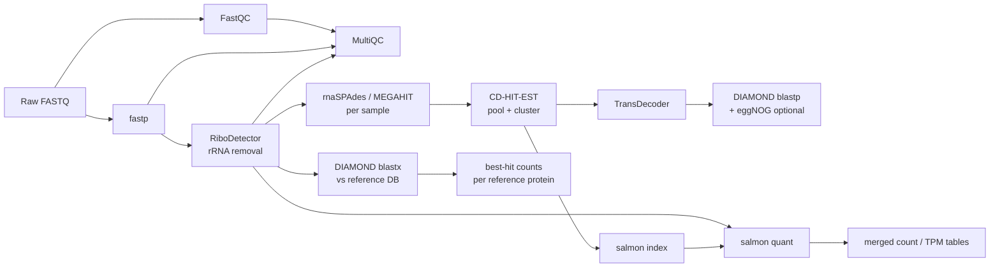

# euk-bot

Nextflow (DSL2) pipeline that processes paired-end metatranscriptome FASTQ into count tables, with a shared QC front end and two analysis branches.



## Layout

```
main.nf                       entry point: samplesheet parsing, param checks, branch switches
nextflow.config               params, profiles, run reports
conf/
  base.config                 resource labels (process_low/medium/high/high_memory), retry policy
  modules.config              publishDir rules -> results/ layout
  slurm.config                SLURM executor, account/queue, per-node resource caps
  test.config                 tiny dataset for wiring checks
subworkflows/local/
  qc_preprocess.nf            FastQC, fastp, RiboDetector, MultiQC
  assembly.nf                 assembly -> cluster -> ORFs -> annotation -> salmon
  reference_map.nf            DIAMOND blastx of reads -> hit counts
modules/local/                one process per tool (conda env + stub block each)
bin/                          helper scripts (auto-added to PATH by Nextflow)
assets/samplesheet_example.csv
tests/                        test samplesheet + toy reads
```

## Running

Samplesheet (CSV): `sample,fastq_1,fastq_2`. See `assets/samplesheet_example.csv`. Rows that share a `sample` (e.g. one per lane) are concatenated before QC.

Build one from a directory of Illumina `*_S*_L00*_R{1,2}_001.fastq.gz` files (`-n` keeps only the first N samples, for test runs):

```bash
python3 bin/make_samplesheet.py /path/to/raw-reads -o samplesheet.csv -n 3
```

```bash
nextflow run main.nf -profile slurm,conda \
    --input samplesheet.csv \
    --outdir results \
    --reference_dmnd /path/to/MarFERReT.dmnd \
    --reference_taxonomy /path/to/MarFERReT_taxonomy.tsv \
    --slurm_account <account> \
    -resume
```

To keep the head job alive, run it from a login-node `tmux`/`screen` session or submit it as a small long-walltime SLURM job.

Common switches:

| Param | Default | Notes |
|---|---|---|
| `--run_assembly` / `--run_reference` | `true` / `true` | turn either branch off |
| `--assembler` | `rnaspades` | or `megahit` |
| `--cdhit_identity` | `0.98` | clustering threshold for pooled contigs |
| `--eggnog_data_dir` | none | set it to run eggNOG-mapper on predicted proteins |
| `--skip_rrna_removal` | `false` | |
| `--ribodetector_read_len` | `150` | set to the sequencing read length |
| `--ribodetector_chunk_size` | `240` | lower if RiboDetector runs out of memory |
| `--save_trimmed`, `--save_non_rrna` | `false` | publish intermediate reads |

Wiring check (no tools run; run from repo root):

```bash
nextflow run main.nf -profile test -stub-run
```

## Outputs (`results/`)

```
qc/{fastqc_raw,fastp,ribodetector,multiqc}/   ribodetector/rrna_summary.tsv = % rRNA per sample
assembly/per_sample/            <sample>.contigs.fa (IDs prefixed with sample)
assembly/clustered/             clustered_contigs.fa (+ .clstr)
assembly/transdecoder/          .pep / .cds / .gff3
assembly/annotation/            proteins_vs_reference.tsv, eggNOG annotations
assembly/salmon/<sample>/       quant.sf
assembly/tables/                salmon_numreads.tsv, salmon_tpm.tsv
reference/diamond_blastx/       <sample>.blastx.tsv
reference/tables/               reference_hit_counts.tsv (long: sample, sseqid, n_reads, taxonomy...)
pipeline_info/                  timeline, report, trace, DAG
```

## TODO / next steps

- Container profile (Apptainer) as an alternative to conda on the cluster.
- Optional co-assembly by sample group (e.g. a `group` column in the samplesheet).
- Swap in EUKulele for consensus taxonomy on the assembly branch, if preferred.
- Join `proteins_vs_reference.tsv` and the salmon tables into a contig-level taxonomy + function + counts table.
