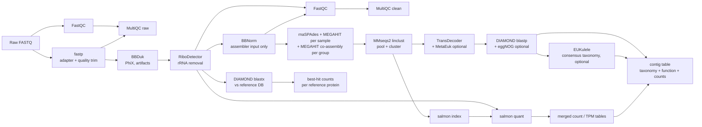

# euk-bot

Nextflow (DSL2) pipeline that processes paired-end metatranscriptome FASTQ into count tables, with a shared QC front end and two analysis branches.



## Layout

```
main.nf                       entry point: samplesheet parsing, param checks, branch switches
nextflow.config               params, profiles, run reports
conf/
  base.config                 resource labels (process_low/medium/high/high_memory), retry policy
  modules.config              publishDir rules -> results/ layout
  slurm.config                SLURM executor, account/queue, per-node resource caps
  test.config                 tiny dataset for wiring checks
subworkflows/local/
  preliminary_qc.nf           step 1, Preliminary QC: FastQC, fastp, BBDuk, RiboDetector, BBNorm, MultiQC before/after,
                              per-sample QC table, read-loss check
  assembly.nf                 assembly -> cluster -> ORFs -> annotation (+ EUKulele) -> salmon -> contig table
  assembly_qc.nf              optional per-assembly QC (seqkit, read mapping rate, BUSCO)
  read_screening.nf           step 2, Read screening (optional): strandedness, sourmash, Nonpareil, Kaiju,
                              suggested co-assembly groups
  methods.nf                  writes <outdir>/methods.txt
  reference_map.nf            DIAMOND blastx of reads -> hit counts
modules/local/                one process per tool (conda env + stub block each)
bin/                          helper scripts (auto-added to PATH by Nextflow)
assets/samplesheet_example.csv
tests/                        test samplesheet + toy reads
```

## Running

Samplesheet (CSV): `sample,fastq_1,fastq_2[,group]`. See `assets/samplesheet_example.csv`. Rows that share a `sample` (e.g. one per lane) are concatenated before QC. The optional `group` column (e.g. vent site or habitat) defines co-assemblies: samples in a group are pooled and co-assembled, in addition to the per-sample assemblies.

Build one from a directory of Illumina `*_S*_L00*_R{1,2}_001.fastq.gz` files (`-n` keeps only the first N samples, for test runs):

```bash
python3 bin/make_samplesheet.py /path/to/raw-reads -o samplesheet.csv -n 3
```

```bash
nextflow run main.nf -profile slurm,singularity \
    --input samplesheet.csv \
    --outdir results \
    --reference_dmnd /scratch/group/hu-lab/databases/euk-bot-ref/v1/euk-bot-ref.v1.dmnd \
    --reference_taxonomy /scratch/group/hu-lab/databases/euk-bot-ref/v1/euk-bot-ref.v1.taxonomy.tsv.gz \
    --reference_annotations /scratch/group/hu-lab/databases/euk-bot-ref/v1_eggnog/euk-bot-ref.v1.emapper.annotations.tsv.gz \
    --eukulele_db /scratch/group/hu-lab/databases/euk-bot-ref/v1_eukulele \
    --slurm_account <account> \
    -resume
```

To keep the head job alive, run it from a login-node `tmux`/`screen` session or submit it as a small long-walltime SLURM job.

Common switches:

| Param | Default | Notes |
|---|---|---|
| `--run_assembly` / `--run_reference` | `true` / `true` | turn either branch off |
| `--assemblers` | `rnaspades,megahit` | per-sample assemblers |
| `--coassembly_assemblers` | `megahit` | per-group co-assemblers (needs a `group` column); `''` turns co-assembly off |
| `--cluster_identity` / `--cluster_coverage` | `0.98` / `0.9` | MMseqs2 linclust thresholds for pooled contigs |
| `--run_read_profiling` | `false` | pre-assembly read profile (`qc/read_profile/read_profile.tsv`): sourmash similarity, Nonpareil, strandedness, Kaiju, suggested groups |
| `--stop_after_profiling` | `false` | run QC + read profiling only, to choose co-assembly groups before assembling |
| `--profile_group_similarity` | `0.5` | sourmash similarity cutoff for suggested groups |
| `--strand_check_dmnd` / `--kaiju_db` | none | protein DB for strandedness (default `--reference_dmnd`); Kaiju DB dir from `download_kaiju.sbatch` (Kaiju skipped if unset; nr_euk needs ~204 GB RAM) |
| `--strandedness` | `auto` | library type for rnaSPAdes (`--ss`): `auto` uses each sample's strandedness call (`rf`/`fr`; otherwise unstranded) and needs a protein DB above; or `rf` (dUTP/TruSeq Stranded), `fr`, `unstranded` for all samples. MEGAHIT has no stranded mode; salmon detects the library type itself (`-l A`) |
| `--run_assembly_qc` | `false` | per-assembly contig stats, read mapping rate and (with `--busco_db_dir`) BUSCO, before clustering |
| `--busco_db_dir` / `--busco_lineages` | none / `eukaryota_odb12` | BUSCO datasets from `download_busco.sbatch` |
| `--eggnog_data_dir` | none | set it to run eggNOG-mapper on predicted proteins |
| `--eukulele_db` | none | EUKulele reference folder from `build_eukulele_db.sbatch`; consensus taxonomy (EUKulele, default cutoffs) of the predicted proteins from their DIAMOND hits, which are then kept for the top 100 per protein. Needs `--reference_dmnd` |
| `--reference_annotations` | none | eggNOG-mapper annotations of the reference proteins (`annotate_reference_db.sbatch`); the contig table gets the eggNOG annotation of each protein's best reference hit, without running eggNOG-mapper on the assembly |
| `--min_read_length` | `50` | fastp minimum length after trimming |
| `--max_pct_removed_fastp` | `30` | QC check: if a sample loses more than this % of read pairs in fastp, the run stops after Preliminary QC (when `--min_read_length` > 36) so you can rerun with `--min_read_length 36 -resume`; at 36 or below it only warns |
| `--trim_mean_quality` | `15` | fastp sliding-window (4 bp) quality trimming, like Trimmomatic `SLIDINGWINDOW:4:15` |
| `--skip_bbduk` / `--bbduk_ref` | `false` / `phix,artifacts` | BBDuk PhiX + Illumina artifact filter (BBTools built-in references) |
| `--skip_normalization` | `false` | BBNorm on the assembler input only (salmon and reference mapping use all clean reads) |
| `--bbnorm_target` / `--bbnorm_mindepth` | `100` / `2` | BBNorm target k-mer depth; k-mers below mindepth ignored (BBNorm's default 5 drops rare transcripts) |
| `--metaeuk_db` | none | MMseqs2 DB folder from `build_metaeuk_db.sbatch`; runs MetaEuk next to TransDecoder, both protein sets annotated |
| `--metaeuk_tmpdir` | task work dir | where MetaEuk writes its temporary files; with the full v1 reference they pass 500 GB, more than personal scratch holds, so point it at group scratch (e.g. `/scratch/group/hu-lab/tmp`). Removed when the task ends |
| `--skip_rrna_removal` | `false` | |
| `--ribodetector_read_len` | `150` | set to the sequencing read length |
| `--ribodetector_chunk_size` | `240` | lower if RiboDetector runs out of memory |
| `--save_trimmed`, `--save_non_rrna`, `--save_normalized` | `false` | publish intermediate reads |
| `--save_rrna` | `true` | publish the rRNA reads removed by RiboDetector (`reads/rRNA/`) for separate 18S analysis |

Wiring check (no tools run; run from repo root):

```bash
nextflow run main.nf -profile test -stub-run
```

### Choosing co-assembly groups

1. Run QC + profiling only: `--stop_after_profiling` (add `--strand_check_dmnd`, `--kaiju_db` if available).
2. Open `qc/read_profile/read_profile.tsv`: `suggested_group` clusters samples by read similarity; a low
   `mean_similarity_within_samplesheet_group` flags a sample that doesn't match its assigned group.
   Fill in `my_group` (and `my_notes`) yourself.
3. `python3 bin/apply_groups.py read_profile.tsv samplesheet.csv -o samplesheet_grouped.csv` writes `my_group`
   into the samplesheet's `group` column (`--fallback suggested|samplesheet` fills blanks).
4. Run the full pipeline with that samplesheet and `-resume`, so QC isn't repeated.

## Outputs (`results/`)

```
qc/read_profile/                read_profile.tsv, samplesheet_suggested.csv, sourmash_similarity.csv, per-sample Nonpareil/strandedness/Kaiju
methods.txt                     software, versions and key arguments of each step the run used (written at launch)
qc/preliminary_qc.tsv           per sample: raw read pairs split into removed by fastp / BBDuk / rRNA / non-rRNA (counts
                                and % of raw, summing to 100), pairs kept by BBNorm, fastp quality metrics, qc_flag
qc/multiqc/                     raw_multiqc_report.html (FastQC raw + fastp), clean_multiqc_report.html (FastQC of
                                clean + normalized reads, BBDuk)
qc/{fastqc_raw,fastqc_clean,fastp,bbduk,ribodetector,bbnorm}/   ribodetector/rrna_summary.tsv = % rRNA per sample
reads/rRNA/                     <sample>.rRNA_{1,2}.fq.gz (with --save_rrna, default on)
assembly/contigs/               <sample|coasm_group>.<assembler>.contigs.fa (IDs prefixed the same way)
assembly/qc/                    assembly_qc.tsv: one row per assembly (contig stats, % reads mapped back, BUSCO), with --run_assembly_qc
assembly/clustered/             clustered_contigs.fa, clustered_contigs_clusters.tsv (representative, member)
assembly/transdecoder/          .pep / .cds / .gff3
assembly/metaeuk/               clustered_contigs.metaeuk.fas (proteins) / .codon.fas / .gff / .headersMap.tsv, with --metaeuk_db
assembly/annotation/            <orf_caller>.proteins_vs_reference.tsv (DIAMOND outfmt 6, 12 standard columns; best hit,
                                or top 100 with --eukulele_db), <orf_caller>.emapper.annotations,
                                <orf_caller>.eukulele_taxonomy.tsv (+ .eukulele_logs/), orf_caller = transdecoder | metaeuk
assembly/salmon/<sample>/       quant.sf
assembly/tables/                salmon_numreads.tsv, salmon_tpm.tsv,
                                contig_table.tsv: one row per clustered contig, see below; protein_table.tsv: one row per protein
reference/diamond_blastx/       <sample>.blastx.tsv
reference/tables/               reference_hit_counts.tsv (long: sample, sseqid, n_reads, taxonomy...)
pipeline_info/                  timeline, report, trace, DAG
```

### Contig table

`assembly/tables/contig_table.tsv` (`bin/build_contig_table.py`) has one row per clustered contig (the rows of
`salmon_numreads.tsv`): `contig`, `length`, `n_proteins`, then the columns of the contig's representative protein,
then the salmon NumReads of each sample. The representative is the protein with the best reference hit (bitscore),
then one with an eggNOG annotation, then the longest; `protein_table.tsv` has the same columns for every protein.
Contigs without a predicted protein are kept with empty annotation. Column groups, each present when its input is:

| Columns | From |
|---|---|
| `orf_caller`, `protein_id`, `protein_length` | TransDecoder / MetaEuk |
| `ref_hit`, `ref_pident`, `ref_evalue`, `ref_bitscore` | best DIAMOND blastp hit (`--reference_dmnd`) |
| `ref_source`, `ref_organism`, `ref_lineage`, ... | the hit's row in `--reference_taxonomy` |
| `ref_eggnog_Preferred_name`, `ref_eggnog_KEGG_ko`, ... | the hit's eggNOG annotation (`--reference_annotations`) |
| `eukulele_classification_level`, `eukulele_classification`, `eukulele_full_classification`, `eukulele_ambiguous` | EUKulele (`--eukulele_db`) |
| `eggnog_Preferred_name`, `eggnog_KEGG_ko`, ... | eggNOG-mapper on the protein itself (`--eggnog_data_dir`) |

eggNOG columns kept: Preferred_name, Description, COG_category, EC, KEGG_ko, KEGG_Pathway, KEGG_Module, CAZy, PFAMs,
max_annot_lvl. TPM per contig is in `salmon_tpm.tsv` (same contig IDs).

## Reference database

The reference branch uses one combined DIAMOND DB: MarFERReT v1.1.1 + EukProt v3 + the prokaryotes of PhyloDB 1.076,
with sequences duplicated across sources removed. `build_reference_db.sbatch` builds it on Grace (after `prebuild_envs.sh`). Each build is a read-only version folder;
bump `REF_VERSION` when a source changes, and cite the version used for a run.

```
/scratch/group/hu-lab/databases/euk-bot-ref/v1/
  euk-bot-ref.v1.dmnd               --reference_dmnd
  euk-bot-ref.v1.taxonomy.tsv.gz    --reference_taxonomy (protein_id, source, organism, ncbi_taxid, lineage, lineage_source, pfam)
  MANIFEST.txt                      source files + md5, merge counts, DIAMOND version, euk-bot commit
```

| Version | Sources |
|---|---|
| v1 | MarFERReT v1.1.1, EukProt v3 (2021_11_22), PhyloDB 1.076 (Bacteria + Archaea only), PR2 taxonomy for EukProt lineages |

A copy of each version's manifest is kept in `assets/reference_db/euk-bot-ref.<version>.MANIFEST.txt`.
`annotate_reference_db.sbatch` runs eggNOG-mapper over a version as a SLURM array (split, run, merge) into
`<version>_eggnog/` beside it (KEGG KO/pathways, Pfam, COG, GO for every protein with an eggNOG hit).
`build_metaeuk_db.sbatch` builds the MMseqs2 version of a version's proteins for MetaEuk (`<version>_mmseqs/`, `--metaeuk_db`).
`build_eukulele_db.sbatch` writes EUKulele's `tax-table.txt` and `prot-map.json` for a version (`<version>_eukulele/`,
`--eukulele_db`; the proteins and DIAMOND DB are symlinks into the version folder). EUKulele's ranks are Domain,
Supergroup, Division, Class, Order, Family, Genus, Species: PR2 lineages drop Subdivision, PhyloDB prokaryotes repeat
Domain as Supergroup (as EUKulele's own PhyloDB table does), and UniEuk lineages (EukProt genera not in PR2; unranked)
keep only Domain and, where the lineage has a binomial, Genus and Species (see `bin/make_eukulele_db.py`).
`reference_db_stats.sbatch` writes summary tables for a version (sizes, length distribution, per-organism
taxonomy, Pfam coverage, and KEGG coverage once the eggNOG annotations exist) to
`assets/reference_db/euk-bot-ref.<version>.stats/`.

Eukaryote lineages use PR2 ranks (MarFERReT's PR2 taxonomy; EukProt via PR2 genus match, else UniEuk, see `lineage_source`).

## TODO / next steps

- Contig table: a contig-level EUKulele consensus across all of a contig's proteins (now: the representative protein's).
