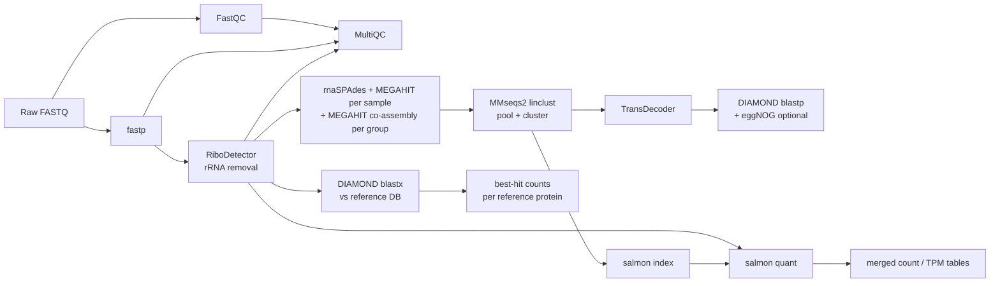

# euk-bot

Nextflow (DSL2) pipeline that processes paired-end metatranscriptome FASTQ into count tables, with a shared QC front end and two analysis branches.



## Layout

```
main.nf                       entry point: samplesheet parsing, param checks, branch switches
nextflow.config               params, profiles, run reports
conf/
  base.config                 resource labels (process_low/medium/high/high_memory), retry policy
  modules.config              publishDir rules -> results/ layout
  slurm.config                SLURM executor, account/queue, per-node resource caps
  test.config                 tiny dataset for wiring checks
subworkflows/local/
  qc_preprocess.nf            FastQC, fastp, RiboDetector, MultiQC
  assembly.nf                 assembly -> cluster -> ORFs -> annotation -> salmon
  assembly_qc.nf              optional per-assembly QC (seqkit, read mapping rate, BUSCO)
  read_profile.nf             optional pre-assembly read profile and suggested co-assembly groups
  reference_map.nf            DIAMOND blastx of reads -> hit counts
modules/local/                one process per tool (conda env + stub block each)
bin/                          helper scripts (auto-added to PATH by Nextflow)
assets/samplesheet_example.csv
tests/                        test samplesheet + toy reads
```

## Running

Samplesheet (CSV): `sample,fastq_1,fastq_2[,group]`. See `assets/samplesheet_example.csv`. Rows that share a `sample` (e.g. one per lane) are concatenated before QC. The optional `group` column (e.g. vent site or habitat) defines co-assemblies: samples in a group are pooled and co-assembled, in addition to the per-sample assemblies.

Build one from a directory of Illumina `*_S*_L00*_R{1,2}_001.fastq.gz` files (`-n` keeps only the first N samples, for test runs):

```bash
python3 bin/make_samplesheet.py /path/to/raw-reads -o samplesheet.csv -n 3
```

```bash
nextflow run main.nf -profile slurm,singularity \
    --input samplesheet.csv \
    --outdir results \
    --reference_dmnd /path/to/MarFERReT.dmnd \
    --reference_taxonomy /path/to/MarFERReT_taxonomy.tsv \
    --slurm_account <account> \
    -resume
```

To keep the head job alive, run it from a login-node `tmux`/`screen` session or submit it as a small long-walltime SLURM job.

Common switches:

| Param | Default | Notes |
|---|---|---|
| `--run_assembly` / `--run_reference` | `true` / `true` | turn either branch off |
| `--assemblers` | `rnaspades,megahit` | per-sample assemblers |
| `--coassembly_assemblers` | `megahit` | per-group co-assemblers (needs a `group` column); `''` turns co-assembly off |
| `--cluster_identity` / `--cluster_coverage` | `0.98` / `0.9` | MMseqs2 linclust thresholds for pooled contigs |
| `--run_read_profiling` | `false` | pre-assembly read profile (`qc/read_profile/read_profile.tsv`): sourmash similarity, Nonpareil, strandedness, Kaiju, suggested groups |
| `--stop_after_profiling` | `false` | run QC + read profiling only, to choose co-assembly groups before assembling |
| `--profile_group_similarity` | `0.5` | sourmash similarity cutoff for suggested groups |
| `--strand_check_dmnd` / `--kaiju_db` | none | protein DB for strandedness (default `--reference_dmnd`); Kaiju DB dir from `download_kaiju.sbatch` (Kaiju skipped if unset; nr_euk needs ~204 GB RAM) |
| `--run_assembly_qc` | `false` | per-assembly contig stats, read mapping rate and (with `--busco_db_dir`) BUSCO, before clustering |
| `--busco_db_dir` / `--busco_lineages` | none / `eukaryota_odb12` | BUSCO datasets from `download_busco.sbatch` |
| `--eggnog_data_dir` | none | set it to run eggNOG-mapper on predicted proteins |
| `--skip_rrna_removal` | `false` | |
| `--ribodetector_read_len` | `150` | set to the sequencing read length |
| `--ribodetector_chunk_size` | `240` | lower if RiboDetector runs out of memory |
| `--save_trimmed`, `--save_non_rrna` | `false` | publish intermediate reads |
| `--save_rrna` | `true` | publish the rRNA reads removed by RiboDetector (`reads/rRNA/`) for separate 18S analysis |

Wiring check (no tools run; run from repo root):

```bash
nextflow run main.nf -profile test -stub-run
```

### Choosing co-assembly groups

1. Run QC + profiling only: `--stop_after_profiling` (add `--strand_check_dmnd`, `--kaiju_db` if available).
2. Open `qc/read_profile/read_profile.tsv`: `suggested_group` clusters samples by read similarity; a low
   `mean_similarity_within_samplesheet_group` flags a sample that doesn't match its assigned group.
   Fill in `my_group` (and `my_notes`) yourself.
3. `python3 bin/apply_groups.py read_profile.tsv samplesheet.csv -o samplesheet_grouped.csv` writes `my_group`
   into the samplesheet's `group` column (`--fallback suggested|samplesheet` fills blanks).
4. Run the full pipeline with that samplesheet and `-resume`, so QC isn't repeated.

## Outputs (`results/`)

```
qc/read_profile/                read_profile.tsv, samplesheet_suggested.csv, sourmash_similarity.csv, per-sample Nonpareil/strandedness/Kaiju
qc/{fastqc_raw,fastp,ribodetector,multiqc}/   ribodetector/rrna_summary.tsv = % rRNA per sample
reads/rRNA/                     <sample>.rRNA_{1,2}.fq.gz (with --save_rrna, default on)
assembly/contigs/               <sample|coasm_group>.<assembler>.contigs.fa (IDs prefixed the same way)
assembly/qc/                    assembly_qc.tsv: one row per assembly (contig stats, % reads mapped back, BUSCO), with --run_assembly_qc
assembly/clustered/             clustered_contigs.fa, clustered_contigs_clusters.tsv (representative, member)
assembly/transdecoder/          .pep / .cds / .gff3
assembly/annotation/            proteins_vs_reference.tsv, eggNOG annotations
assembly/salmon/<sample>/       quant.sf
assembly/tables/                salmon_numreads.tsv, salmon_tpm.tsv
reference/diamond_blastx/       <sample>.blastx.tsv
reference/tables/               reference_hit_counts.tsv (long: sample, sseqid, n_reads, taxonomy...)
pipeline_info/                  timeline, report, trace, DAG
```

## Reference database

The reference branch uses one combined DIAMOND DB: MarFERReT v1.1.1 + EukProt v3 + the prokaryotes of PhyloDB 1.076,
with sequences duplicated across sources removed. `build_reference_db.sbatch` builds it on Grace (after `prebuild_envs.sh`). Each build is a read-only version folder;
bump `REF_VERSION` when a source changes, and cite the version used for a run.

```
/scratch/group/hu-lab/databases/euk-bot-ref/v1/
  euk-bot-ref.v1.dmnd               --reference_dmnd
  euk-bot-ref.v1.taxonomy.tsv.gz    --reference_taxonomy (protein_id, source, organism, ncbi_taxid, lineage, lineage_source, pfam)
  MANIFEST.txt                      source files + md5, merge counts, DIAMOND version, euk-bot commit
```

| Version | Sources |
|---|---|
| v1 | MarFERReT v1.1.1, EukProt v3 (2021_11_22), PhyloDB 1.076 (Bacteria + Archaea only), PR2 taxonomy for EukProt lineages |

A copy of each version's manifest is kept in `assets/reference_db/euk-bot-ref.<version>.MANIFEST.txt`.
`annotate_reference_db.sbatch` runs eggNOG-mapper over a version as a SLURM array (split, run, merge) into
`<version>_eggnog/` beside it (KEGG KO/pathways, Pfam, COG, GO for every protein with an eggNOG hit).
`reference_db_stats.sbatch` writes summary tables for a version (sizes, length distribution, per-organism
taxonomy, Pfam coverage, and KEGG coverage once the eggNOG annotations exist) to
`assets/reference_db/euk-bot-ref.<version>.stats/`.

Eukaryote lineages use PR2 ranks (MarFERReT's PR2 taxonomy; EukProt via PR2 genus match, else UniEuk, see `lineage_source`).

## TODO / next steps

- Swap in EUKulele for consensus taxonomy on the assembly branch, if preferred.
- Join `proteins_vs_reference.tsv` and the salmon tables into a contig-level taxonomy + function + counts table.
